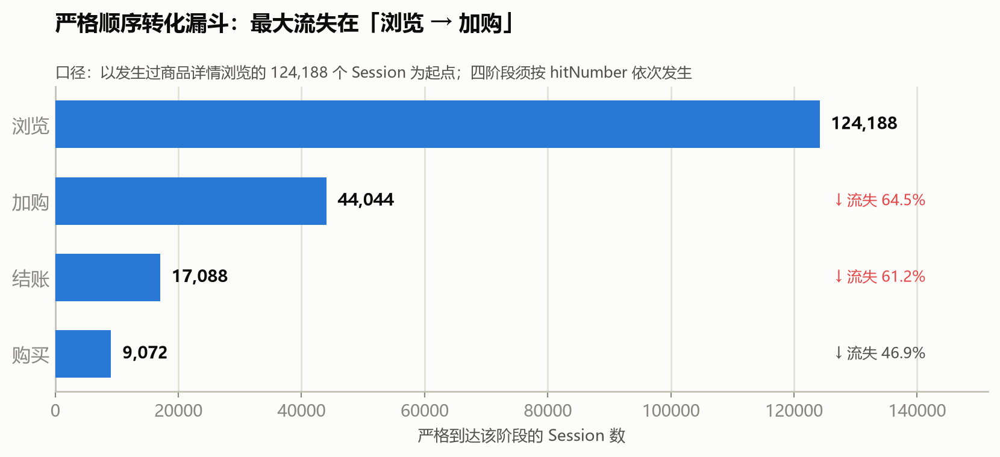
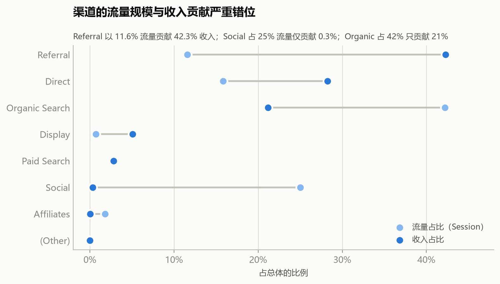
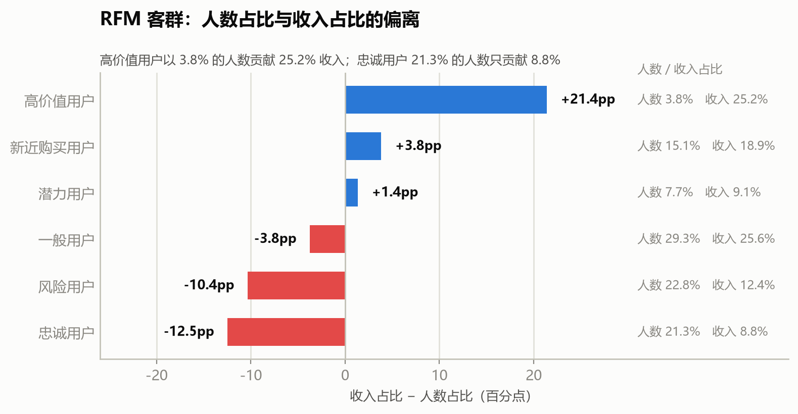
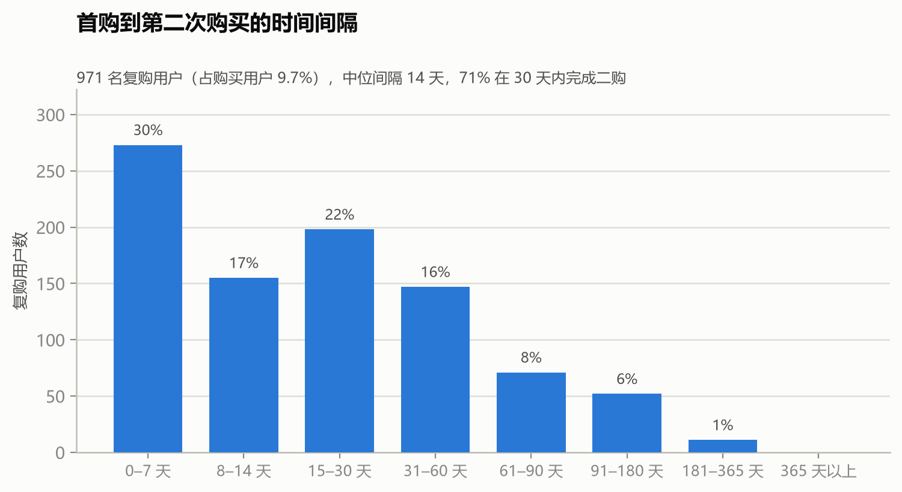

# GA360 电商漏斗与用户生命周期分析

基于 Google Analytics 360 Sample（Google Merchandise Store）2016-08-01 ~ 2017-08-01 一整年匿名化电商数据，
完成「原始数据 → 统计口径 → 经营基线 → 行为漏斗 → 用户价值与生命周期 → 业务建议」的完整观察性分析。

**714,167 UV ｜ 903,653 Session ｜ 596,585 核心行为事件 ｜ 12,115 笔交易 ｜ $1,540,071 收入**

## 核心发现

| # | 结论 | 关键数字 |
|---|---|---|
| 1 | **最大流失在「浏览→加购」，不是支付** | 相邻流失 64.5%，而「结账→购买」通过率 53.1% 是全程最高 |
| 2 | **渠道的流量与收入严重错位** | Referral 用 11.6% 流量贡献 42.3% 收入；Social 占 25% 流量只贡献 0.3% |
| 3 | **回访用户才是收入主体** | 22.2% 的 Session 贡献 75.2% 收入，购买率是新客的 5.5 倍 |
| 4 | **价值高度集中** | 3.8% 的高价值用户贡献 25.2% 收入，人均为全站的 6.57 倍 |
| 5 | **复购窗口只有两周** | 90.31% 的买家只买过一次；71.1% 的二购发生在首购后 30 天内（中位 14 天） |









## 项目简介

本项目使用 Google Analytics 360 Sample 数据，对 Google Merchandise Store 的用户访问、渠道表现、电商行为漏斗、订单和用户价值进行观察性分析。

> 完整的项目说明（数据资产、逐章方法、全部指标口径、已知弱点与常见追问）见 [docs/PROJECT_BRIEF.md](docs/PROJECT_BRIEF.md)。

项目已完成 Python Notebook 分析，并配套制作了 Tableau Public 可交互看板（KPI 概览、渠道经营、转化漏斗、RFM 用户价值分层）。

## 分析问题

1. 不同渠道带来的流量规模、购买效率和收入贡献有什么差异？
2. 用户主要在哪个电商漏斗阶段流失？
3. 新用户和回访用户的购买行为有什么差异？
4. 哪些购买用户属于高价值、忠诚、潜力或风险客群？
5. 买过的用户会不会回来、多久回来、回来贡献多少？
6. 哪些分析结果适合转化为渠道、页面和用户运营策略？

# GA360 数据来源

## Google Analytics 360 Sample

- 发布方：Google
- 来源：经过模糊处理的 Google Merchandise Store 真实电商数据
- 官方说明：https://support.google.com/analytics/answer/7586738
- 公共表：`bigquery-public-data.google_analytics_sample.ga_sessions_*`
- 访问方式：Google Cloud BigQuery Sandbox 或免费层级
- 查询项目：`comp7506ws1-7518afb2`
- 日期范围：2016-08-01 至 2017-08-01，首尾日期均包含

## 本地文件

- `data/raw/ga360/ga360_sessions.csv`：会话级字段，903,653 行。
- `data/raw/ga360/ga360_funnel_hits.csv`：关键电商命中级字段，596,585 行。
- `data/raw/ga360/SHA256SUMS.txt`：CSV SHA-256 校验清单。

> 原始数据体积较大（约 228MB），未纳入版本库，需自行从 BigQuery 导出到上述路径。

## 字段边界

会话文件包括用户、会话、日期、渠道、source/medium、设备、地区、新老客、页面行为和交易汇总字段。

关键行为编码：

| `actionType` | 行为 |
|---:|---|
| `2` | 商品详情浏览 |
| `3` | 加入购物车 |
| `5` | 进入结账 |
| `6` | 完成购买 |

项目采用的严格漏斗为：

```text
商品浏览 → 加入购物车 → 进入结账 → 完成购买
```

## 统计口径

- 用户：`fullVisitorId`
- Session：`fullVisitorId + date + visitId` 构造的 `session_key`
  （候选键 `fullVisitorId + visitId` 经 DuckDB 六维审计发现跨日期复用，故将 `date` 纳入键）
- 漏斗：按 `session_key` 聚合，不直接统计事件行数
- 订单：按非空 `transactionId` 去重
- 收入：原始微单位收入除以 1,000,000，转换为美元
- RFM：只对购买用户计算 Recency、Frequency 和 Monetary
- 生命周期：按 `fullVisitorId` 的首购月划分 cohort

**三个购买率，不可混用：** Session 购买率 1.28%（分母 903,653）｜ 严格漏斗最终转化 7.31%（分母 124,188，仅含有商品浏览的会话）｜ 用户购买率 1.40%

**两个收入，不可混用：** Session 表收入 $1,540,071.24（会话级汇总）｜ 订单表收入 $1,627,429.54（按订单去重逐笔加总）

## Notebook 结构

主 Notebook：

```text
notebooks/GA360_ecommerce_analysis.ipynb
```

结构为一篇完整报告：开头包含 **引言部分**（项目背景、数据来源、分析目标、研究框架与统计口径）与 **执行摘要**（核心结论速览），其后是 5 个分析章节：

| 章节 | 内容 |
|---|---|
| 引言 | 项目背景、数据来源、分析目标、研究框架与统计口径 |
| 执行摘要 | 核心结论速览（经营基线、渠道、漏斗、RFM） |
| 1 | 数据资产审计与分析口径定义 |
| 2 | 用户、Session 与渠道经营基线 |
| 3 | 电商行为路径与严格转化漏斗 |
| 4 | 订单去重、RFM 用户价值分层与用户生命周期（4.6） |
| 5 | 业务洞察、策略建议与分析边界 |

本项目已跳过时间窗口流失预测章节。原因是当前数据观察期在 2017-08-01 截止，无法为末期用户提供完整的未来观察窗口；同时，流失标签存在明显类别不平衡。后续获得更长时间范围的数据后，可单独扩展该分析。

## 已验证的核心结果

- UV：714,167
- Session：903,653
- 购买 Session：11,552
- Session 购买率：1.28%
- 交易数：12,115
- Session 表收入：约 `$1,540,071.24`
- 严格漏斗浏览 Session：124,188
- 严格漏斗购买 Session：9,072
- 严格漏斗最终转化率：7.31%
- 去重订单：11,552
- 购买用户：10,022
- 订单表收入：约 `$1,627,429.54`
- 复购用户（≥2 单）：971（9.69%）
- 首购→二购中位间隔：14 天，71.1% 在 30 天内
- 人均累计消费：首购当月 $131.18 → 第 3 月 $154.26 → 末期 $162.39（首月即占 80.8%）

主要业务发现：

- Referral 渠道购买效率和收入贡献较高（11.6% 流量贡献 42.3% 收入）。
- Social 渠道购买率较低且跳出率较高，是"大流量、低价值"渠道。
- 回访用户购买率明显高于新用户（漏斗最终转化 13.23% vs 4.28%）。
- 浏览到加购、加购到结账是漏斗中优先优化的早期环节（流失 64.5% / 61.2%）。
- 高价值用户人数较少（3.8%）但人均消费较高（贡献 25.2% 收入，人均 6.57 倍）。
- 复合洞察：高价值用户几乎全部集中在 `Referral × desktop × 新用户`。
- 复购几乎只发生在首购后两周内，且只有 9.69% 的买家产生过第二次购买。

## 输出目录

### 分析表 `outputs/tables/`（29 张）

每个文件的来源章节和字段说明见：

```text
outputs/tables/README.md
```

### 图表 `outputs/figures/`

| 文件 | 内容 |
|---|---|
| `fig_funnel.png` | 严格顺序转化漏斗与相邻流失率 |
| `fig_channel_gap.png` | 渠道流量占比 vs 收入占比（哑铃图） |
| `fig_rfm_gap.png` | RFM 客群人数占比与收入占比的偏离 |
| `fig_repeat_gap.png` | 首购→二购间隔分布 |
| `fig_cohort_retention.png` | 首购 cohort 的月度复购留存热力图 |
| `fig_ltv_curve.png` | 购买用户人均累计消费曲线 |

### 可复现脚本 `scripts/`

| 脚本 | 作用 |
|---|---|
| `build_user_day_kpi.py` | 生成「用户×日期」KPI 基表（供 Tableau 日期联动精确去重 UV） |
| `build_missing_tables.py` | 补齐 Notebook 未直接产出的 10 张表，并与现有文件逐表比对（带 `--write` 落盘） |
| `build_lifecycle.py` | 生成生命周期 4 张表 + 3 张图 |
| `build_report_figures.py` | 生成 README 使用的 3 张总览图 |
| `insert_lifecycle_cells.py` | 将 4.6 生命周期小节写入 Notebook（幂等） |

## 复现步骤

```bash
# 1. 将 BigQuery 导出的两张 CSV 放入 data/raw/ga360/
# 2. 安装依赖
pip install -r requirements.txt

# 3. 运行主 Notebook（产出 17 张表）
jupyter notebook notebooks/GA360_ecommerce_analysis.ipynb

# 4. 补齐其余分析表（默认只比对不覆盖，确认后加 --write）
python scripts/build_missing_tables.py --write

# 5. 生成生命周期表与图
python scripts/build_lifecycle.py

# 6. 生成 README 总览图
python scripts/build_report_figures.py
```

## Tableau 看板

Tableau 看板已完成并嵌入主 Notebook，共四个，均以 `analysis_date` / `channelGrouping` / `user_type` / `deviceCategory` 实现联动筛选：

1. **KPI 概览**：UV、Session、购买率、交易数、收入和跳出率，支持日期筛选联动。
2. **渠道经营**：来源规模 treemap、渠道效率气泡图、时间趋势及新老顾客对比。
3. **转化漏斗**：整体漏斗 + 渠道 / 用户类型 / 设备分组的漏斗拆分，支持多维度筛选联动。
4. **RFM 客群**：客群占比对比、RFM 用户散点、RFM 客群矩阵，识别高价值与风险用户。

**KPI 日期范围联动**：`outputs/tables/user_day_kpi.csv` 为「用户×日期」粒度基表，支持按任意日期范围精确计算 UV（`COUNTD(fullVisitorId)`，表中 `fullVisitorId` 已规范为 1~714167 的序号以避免精度丢失）。`overall_metrics` 之外的所有经营指标均可由此表单源联动。

**多维度漏斗联动**：`outputs/tables/funnel_multi_dim.csv` 为「渠道×用户类型×设备×漏斗阶段」长表，多个漏斗图共用同一数据源实现联动。

**用户主表**：`outputs/tables/user_master.csv` 合并渠道、设备、新老、是否购买与 RFM 客群，用于第 5 章复合洞察。

## 分析边界

- 本项目是观察性经营分析，渠道或客群差异不能直接解释为因果关系。
- Session 购买率、用户购买率、交易数和订单数属于不同统计口径。
- 严格漏斗以「有商品浏览的 Session」为起点，其 7.31% 不能与全站 Session 购买率 1.28% 比较。
- RFM 分层是基于当前观察期分位数的规则型画像，不是绝对价值标签。其中 F 维度区分度弱——
  90.31% 的购买用户只买过 1 单，五分位在低频段接近随机。
- 订单表收入和 Session 表收入来自不同数据粒度，使用时必须明确来源。
- Referral 收入中 94.5% 来自单一 `(direct)/(none)` 组合，归因可靠性存疑，不宜直接解读为"外部推荐带来高转化"。
- 生命周期留存为「购买留存」，与第 2 章的 Session 口径不可混用；观察期仅 12 个月，无法区分"沉默"与"永久流失"。
- 页面、渠道和运营策略需要通过独立 A/B Test 或准实验验证；项目中的增量测算（约 +1,900 单）是乐观上限，不是预测。

## 推荐运行环境

```text
Python 3.12+
pandas
numpy
duckdb
matplotlib
jupyter
pyarrow
openpyxl
```

完整依赖见 `requirements.txt`。Notebook 使用 `ecommerce-growth` Kernel 执行。Tableau 看板不影响 Python 分析结果的复现。
